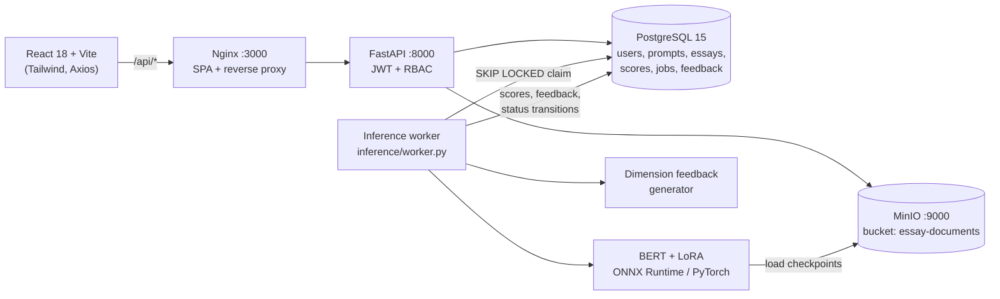

# Automated Essay Scoring

BERT + LoRA scoring for ASAP prompts, with teacher review and per-dimension feedback.

[](https://github.com/raj-aryan-official/Automated-Essay-Scoring/actions/workflows/ci.yml)
[](https://github.com/raj-aryan-official/Automated-Essay-Scoring/actions/workflows/docker-build.yml)
[](https://www.python.org/)
[](https://fastapi.tiangolo.com/)
[](https://react.dev/)
[](https://pytorch.org/)

- **Author:** Raj Aryan (Roll No: 240410700141)
- **Reference:** *A Neural Approach to Automated Essay Scoring* (Taghipour & Ng, EMNLP 2016)

---

## 1. What this is

A full-stack application that scores student essays on the eight ASAP prompts.

- **Scoring:** a `bert-base-uncased` encoder with a LoRA adapter (`r=8`) and a sigmoid-bounded regression head per prompt. Scores are mapped onto that prompt's rubric range (2-12, 1-6, 0-3, 0-4, 0-30, 0-60).
- **Feedback:** a rule-based pass over the essay text produces grammar, coherence, and argumentation notes, each tagged high priority, moderate, or proficient.
- **Human review:** teachers can override a model score with a written justification. The essay moves from `FEEDBACK_READY` to `FINALIZED` and both values are kept.
- **Queue:** scoring jobs live in the database. The worker claims one with `FOR UPDATE SKIP LOCKED`, so multiple workers never pick the same job, and a crashed job is requeued until its attempt limit.
- **Evaluation view:** the model evaluation page reads QWK results from `inference/runs/week7_evaluation.json` and loss curves from `inference/runs/prompt_<n>/scalars.jsonl`. If those files are missing it reports zero results; it does not display placeholder metrics.

---

## 2. Roles and screens

| Screen | Route | VIEWER | TEACHER | ML_ENGINEER | ADMIN |
| :--- | :--- | :---: | :---: | :---: | :---: |
| Dashboard | `/dashboard` | yes | yes | yes | yes |
| Submit essay | `/submit` | no | yes | no | yes |
| Essay manager | `/essays` | yes | yes | yes | yes |
| Essay detail / score workspace | `/essays/:id` | read-only | full | read-only | full |
| Inference jobs | `/jobs` | no | no | yes | yes |
| Model evaluation | `/evaluation` | no | no | yes | yes |

`ADMIN` bypasses role checks everywhere. Every other role is matched against the list of roles allowed on the endpoint or route.

---

## 3. Architecture



The API container starts through `backend/entrypoint.sh`, which waits for the database and runs the idempotent prompt and user seed scripts before starting Uvicorn.

---

## 4. Run with Docker Compose

```bash
git clone https://github.com/raj-aryan-official/Automated-Essay-Scoring.git
cd Automated-Essay-Scoring
cp .env.example .env
docker compose up -d --build
docker compose ps
```

| Service | Address | Notes |
| :--- | :--- | :--- |
| Web app | http://localhost:3000 | Nginx serves the built SPA and proxies `/api` |
| API | http://localhost:8000 | FastAPI root |
| API docs | http://localhost:8000/docs | Swagger UI |
| MinIO console | http://localhost:9001 | `minioadmin` / `minioadmin` |
| MinIO S3 API | http://localhost:9000 | S3-compatible endpoint |
| PostgreSQL | localhost:5432 | `aes_user` / `aes_password`, database `aes_db` |

Compose starts `postgres`, `minio`, `minio-init`, `backend`, `gpu-worker`, and `frontend`. The worker image is CUDA-based; set `INFERENCE_DEVICE=cpu` in `.env` to run without a GPU.

### Seeded accounts

| Role | Email | Password |
| :--- | :--- | :--- |
| ADMIN | `admin@aes.local` | `Admin123!` |
| TEACHER | `teacher@aes.local` | `Teacher123!` |
| ML_ENGINEER | `ml_engineer@aes.local` | `Engineer123!` |
| VIEWER | `viewer@aes.local` | `Viewer123!` |

Change these before exposing the stack anywhere.

---

## 5. Local development

### Backend

```bash
python -m venv .venv
source .venv/bin/activate
pip install -r backend/requirements.txt
cp .env.example .env          # point DATABASE_URL / DATABASE_SYNC_URL at your Postgres instance
uvicorn app.main:app --reload --port 8000 --app-dir backend
```

The entrypoint is skipped when you run Uvicorn directly, so seed once by hand:

```bash
cd backend
python -m app.scripts.seed_prompts
python -m app.scripts.seed_users
```

For a throwaway database, point both URLs at SQLite:

```bash
DATABASE_URL=sqlite+aiosqlite:///./local_dev.db
DATABASE_SYNC_URL=sqlite:///./local_dev.db
```

### Worker

```bash
DATABASE_SYNC_URL=sqlite:///./local_dev.db \
python inference/worker.py
```

The worker polls every `WORKER_POLL_INTERVAL` seconds and retires a job after its attempt limit.

### Frontend

```bash
cd frontend
npm ci
npm run dev        # http://localhost:3000, proxies /api to localhost:8000
npm run build      # type-check and production bundle
```

---

## 6. Essay lifecycle

```
DRAFT -> SUBMITTED -> QUEUED -> PROCESSING -> SCORED -> FEEDBACK_READY -> FINALIZED
                                 -> PROCESSING_FAILED (retried, then terminal)
```

`UNDER_REVIEW` is defined in the status enum and filters but is not emitted by the current review endpoint: a teacher override finalizes the essay in one step.

- Submission accepts pasted text up to 8,000 characters, or a document upload, and stores the row as `SUBMITTED`.
- `POST /api/v1/essays/{id}/score` enqueues a job and returns `202` with the job id.
- The worker claims the job, runs inference, and writes the holistic score, confidence, three dimension scores, and feedback.
- A teacher override writes `reviewer_override_score`, a required reason, and a timestamp, then sets the essay to `FINALIZED`.

---

## 7. API

All routes are under `/api/v1`. Authentication is a JWT bearer token from `/auth/login`.

### Auth

| Method | Path | Access | Purpose |
| :--- | :--- | :--- | :--- |
| `POST` | `/auth/login` | public | Exchange email and password for a token |
| `POST` | `/auth/token` | public | OAuth2 password form, for Swagger's Authorize button |
| `GET` | `/auth/me` | any role | Current user profile and role |

### Prompts

| Method | Path | Access | Purpose |
| :--- | :--- | :--- | :--- |
| `GET` | `/prompts` | VIEWER+ | The eight ASAP prompts with genre and rubric bounds |

### Essays

| Method | Path | Access | Purpose |
| :--- | :--- | :--- | :--- |
| `POST` | `/essays` | TEACHER+ | Create an essay from JSON text or multipart upload (`201`) |
| `GET` | `/essays` | VIEWER+ | Paginated list with prompt, status, and text filters |
| `GET` | `/essays/{id}` | VIEWER+ | Essay detail, including a document download URL when present |
| `POST` | `/essays/{id}/score` | TEACHER+ | Enqueue scoring (`202`, returns `job_id`) |
| `GET` | `/essays/{id}/score` | VIEWER+ | Holistic score, band, confidence, dimensions, override |
| `GET` | `/essays/{id}/jobs/latest` | VIEWER+ | Most recent job for the essay |
| `POST` | `/essays/{id}/review` | TEACHER+ | Override the score with a required reason |

### Jobs and analytics

| Method | Path | Access | Purpose |
| :--- | :--- | :--- | :--- |
| `GET` | `/jobs/{job_id}` | VIEWER+ | Job status and error detail |
| `GET` | `/analytics/summary` | VIEWER+ | Live essay and quality counts for the dashboard |
| `GET` | `/analytics/jobs` | VIEWER+ | Job counts grouped by status |
| `GET` | `/analytics/evaluation` | ML_ENGINEER+ | QWK report, loss curves, live queue counts |

### Health

| Method | Path | Access | Purpose |
| :--- | :--- | :--- | :--- |
| `GET` | `/api/v1/health` | public | Liveness |
| `GET` | `/api/v1/ready` | public | Readiness, checks a database round-trip |
| `GET` | `/` | public | Service discovery and docs link |

---

## 8. Configuration

Every value is read from the environment; `.env.example` has the full set with defaults.

| Variable | Default | Purpose |
| :--- | :--- | :--- |
| `ENVIRONMENT` | `development` | Deployment label |
| `DEBUG` | `True` | FastAPI debug mode |
| `BACKEND_HOST` / `BACKEND_PORT` | `0.0.0.0` / `8000` | Bind address |
| `API_V1_STR` | `/api/v1` | API prefix |
| `SECRET_KEY` / `JWT_SECRET` | placeholder | Signing keys; replace in any shared environment |
| `ACCESS_TOKEN_EXPIRE_MINUTES` | `1440` | Token lifetime |
| `DATABASE_URL` | `postgresql+asyncpg://...` | Async connection string used by the API |
| `DATABASE_SYNC_URL` | `postgresql://...` | Sync connection string used by the worker |
| `POSTGRES_SERVER` / `POSTGRES_PORT` / `POSTGRES_USER` / `POSTGRES_PASSWORD` / `POSTGRES_DB` | `localhost` / `5432` / `aes_user` / `aes_password` / `aes_db` | Compose database settings |
| `S3_ENDPOINT` / `S3_ENDPOINT_URL` | `http://localhost:9000` | Object storage endpoint |
| `S3_ACCESS_KEY` / `S3_SECRET_KEY` | `minioadmin` | Object storage credentials |
| `S3_BUCKET` / `S3_BUCKET_NAME` | `essay-documents` | Bucket for uploads and checkpoints |
| `S3_REGION` | `us-east-1` | S3 region |
| `FRONTEND_ORIGIN` | `http://localhost:5173` | Allowed frontend origin |
| `BACKEND_CORS_ORIGINS` | local 3000/5173/4173 | Allowed CORS origins |
| `MODEL_VERSION` | `aes-bert-v1.0` | Checkpoint tag recorded with each score |
| `MODEL_BASE_NAME` | `bert-base-uncased` | Base encoder |
| `INFERENCE_DEVICE` | `cuda` | `cuda` or `cpu` |
| `CONFIDENCE_THRESHOLD` | `0.75` | Default review threshold shown in the score workspace |
| `BATCH_SIZE` | `8` | Worker batch size |
| `WORKER_POLL_INTERVAL` | `2.0` | Queue poll interval, seconds |
| `VITE_API_BASE_URL` | `http://localhost:8000/api/v1` | API base used when not proxied |

---

## 9. Training, export, and evaluation

Check the environment first:

```bash
python inference/check_env.py
```

### Train a prompt adapter

```bash
python -m inference.app.engine.train \
  --prompt_id 1 \
  --epochs 5 \
  --batch_size 8 \
  --lr 2e-5 \
  --checkpoint_dir inference/checkpoints/1
```

Optional flags: `--log_dir` for TensorBoard scalars, `--config` for a YAML model config. Training writes `scalars.jsonl`, which the evaluation page reads for loss curves.

### Export to ONNX and benchmark latency

```bash
python -m inference.app.engine.export_onnx \
  --prompt_id 1 \
  --checkpoint_dir inference/checkpoints/1 \
  --output_path inference/checkpoints/1/model.onnx
```

Optional flags: `--num_iterations` (default 50), `--nfr_target_ms` (default 300), `--output_json`.

### Verify checkpoint integrity

```bash
python inference/checkpoints/validate_checksums.py
```

### Evaluate against the QWK gate

```bash
python -m inference.app.eval.evaluate \
  --checkpoint_dir inference/checkpoints \
  --prompts all \
  --target_qwk 0.70 \
  --output_json inference/runs/week7_evaluation.json
```

`--prompts` takes `all` or a comma-separated list such as `1,3,7`. `--data_path` points at the ASAP TSV/CSV when it is not in the default location. The report written here is the file served by the model evaluation page.

The project target is a mean QWK of at least 0.70 across the eight prompts. No benchmark numbers are checked into this repository; run the evaluation above to produce them.

---

## 10. Checks

```bash
# Lint
pip install ruff
ruff check backend inference

# Backend tests
pip install -r backend/requirements.txt
pytest backend/tests -q

# Frontend type-check and build
cd frontend && npm ci && npm run build

# Browser flows (backend and worker must be running)
cd frontend && npx playwright test
```

CI runs ruff, a Black check, ESLint, Bandit, a Trivy scan, checkpoint checksum validation, and the test suites on every push.

Frontend accessibility and responsive audits:

```bash
cd frontend && npm run audit:a11y && npm run audit:responsive
```

---

## 11. Repository layout

```
.
├── backend/
│   ├── app/
│   │   ├── api/v1/        # auth, prompts, essays, jobs, analytics
│   │   ├── core/          # settings, database, security, validation
│   │   ├── models/        # SQLAlchemy entities
│   │   ├── schemas/       # Pydantic request and response models
│   │   ├── scripts/       # prompt and user seeds
│   │   └── services/      # job dispatch, S3 storage
│   ├── migrations/        # schema DDL
│   ├── tests/
│   ├── Dockerfile
│   └── entrypoint.sh
├── frontend/
│   ├── src/
│   │   ├── api/           # typed client and interfaces
│   │   ├── components/    # UI primitives, layout, ProtectedRoute
│   │   ├── context/       # auth state
│   │   ├── features/      # scoring workspace, feedback drawer, analytics charts
│   │   └── pages/         # dashboard, submission, essays, jobs, evaluation, login
│   ├── e2e/               # Playwright specs
│   ├── scripts/           # axe and responsive audits
│   ├── nginx.conf
│   └── Dockerfile
├── inference/
│   ├── app/
│   │   ├── dataset/       # ASAP loading and tokenization
│   │   ├── engine/        # train, LoRA, ONNX export
│   │   └── eval/          # QWK metric and evaluation CLI
│   ├── checkpoints/       # weights, ONNX exports, checksums.sha256
│   ├── configs/
│   ├── runs/              # scalars.jsonl and evaluation reports
│   ├── tests/
│   ├── worker.py
│   └── Dockerfile.gpu
├── docker-compose.yml
├── pyproject.toml
└── .env.example
```
